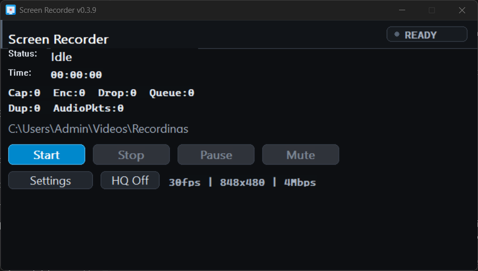
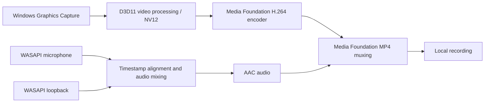
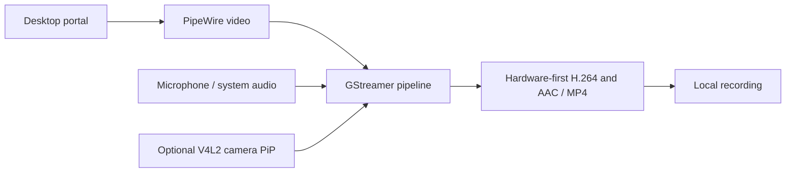

# ScreenRecorder — Free, Lightweight Open-Source Screen Recorder

**A portable, GPU-accelerated screen recorder for Windows 10/11, laptops and low-end PCs, with a separate native Fedora Wayland edition.**

ScreenRecorder is a free, MIT-licensed screen recording application designed for low overhead and straightforward local recording. It prioritizes hardware H.264 encoding, including Intel Quick Sync on compatible Intel Iris Xe and integrated graphics, and records your screen, microphone, system audio and optional webcam overlay to MP4. It is a lightweight alternative to OBS Studio for everyday recording when you do not need a full streaming and scene-composition suite.

The Windows application is built in native C++20 with Win32, Windows Graphics Capture (WGC), Direct3D 11 (D3D11), Media Foundation and WASAPI. The Fedora edition uses GTK4, libadwaita, PipeWire, GStreamer and hardware encoding through VA-API or Quick Sync where available.

[](https://github.com/priyanshuchawda/screen-recorder/releases/download/v0.3.17/ScreenRecorder-0.3.17-windows-x64.zip)
[](https://github.com/priyanshuchawda/screen-recorder/releases/download/fedora-v0.1.5/fedora-screen-recorder-0.1.5-1.fc44.x86_64.rpm)

[](LICENSE)
[](CMakeLists.txt)
[](https://github.com/priyanshuchawda/screen-recorder/stargazers)
[](https://github.com/priyanshuchawda/screen-recorder/releases)

[Website](https://screenrecording.pages.dev/) · [All releases](https://github.com/priyanshuchawda/screen-recorder/releases) · [Fedora documentation](fedora-linux-app/README.md) · [Report a bug](https://github.com/priyanshuchawda/screen-recorder/issues/new)



## Download and install

| Platform | Release | Package | Download |
| --- | --- | --- | --- |
| Windows 10/11 (x64) | v0.3.17 | Portable ZIP | [Download Windows ZIP](https://github.com/priyanshuchawda/screen-recorder/releases/download/v0.3.17/ScreenRecorder-0.3.17-windows-x64.zip) |
| Fedora 44 GNOME/Wayland (x86_64) | fedora-v0.1.5 | Binary RPM, approximately 118 KiB | [Download Fedora RPM](https://github.com/priyanshuchawda/screen-recorder/releases/download/fedora-v0.1.5/fedora-screen-recorder-0.1.5-1.fc44.x86_64.rpm) |

Package sizes are compressed release asset sizes, not installed size, runtime RAM usage or the size of Linux runtime dependencies. Check [all releases](https://github.com/priyanshuchawda/screen-recorder/releases) for newer builds and release notes. Windows and Fedora releases are versioned independently.

### Windows quick start

1. Download the Windows ZIP and extract it to a folder.
2. Run `ScreenRecorder.exe`.
3. Select the resolution, frame rate and output folder in Settings.
4. Configure microphone/system audio and the optional camera overlay, then start recording.
5. Stop recording and allow the MP4 to finish finalizing before closing the app.

No installer or cloud account is required for normal Windows recording. Recordings are saved locally.

### Fedora Linux quick start

Download the binary RPM (not the source RPM) and install it from your Downloads folder:

```bash
cd ~/Downloads
sudo dnf install ./fedora-screen-recorder-0.1.5-1.fc44.x86_64.rpm
```

Launch **Fedora Screen Recorder** from the GNOME app grid, or run:

```bash
gtk-launch io.github.screenrecorder.Fedora
```

Choose a screen or window through the desktop portal. See the [Fedora installation and hardware encoder guide](fedora-linux-app/README.md) for dependencies, Intel media drivers, source builds and troubleshooting.

## Why ScreenRecorder?

- **Lightweight native application:** no Electron or browser runtime in the Windows recording path.
- **Hardware-accelerated screen recording:** uses compatible GPU media encoders before falling back to software.
- **Designed for laptops and integrated graphics:** Intel Iris Xe, Intel Quick Sync and battery-aware recording profiles are development priorities.
- **Screen, voice and desktop sound:** record tutorials, presentations, lectures and coding sessions with microphone and system audio.
- **Optional webcam overlay:** useful for demonstrations and educational recordings.
- **Local, offline workflow:** no account or cloud service is required for recording.
- **Free and open source:** inspect, modify and redistribute the source under the [MIT License](LICENSE).

ScreenRecorder is intentionally focused on recording rather than live streaming, extensive scene composition or full video editing. Actual CPU, GPU, RAM and battery consumption depend on your hardware, drivers, recording settings and workload.

## Features and platform support

The Windows and Fedora applications share the same goals but have separate native implementations.

| Feature | Windows | Fedora 44 GNOME/Wayland |
| --- | --- | --- |
| Screen capture | Primary monitor | Screen or window via desktop portal |
| Video recording | H.264 | H.264 |
| Hardware encoding | Media Foundation, Intel GPU preference | VA low-power, Quick Sync or VA-API |
| Software fallback | H.264 software MFT | OpenH264 |
| Output format | MP4 (H.264 + AAC) | MP4 (H.264 + AAC) |
| Microphone and system audio | WASAPI | PipeWire/PulseAudio-compatible sources |
| Webcam picture-in-picture | Supported | Supported |
| Pause and resume | Supported | Supported |
| Power-aware recording | Supported | Supported |
| Dedicated Battery Saver mode | Planned | Supported |
| Local recording diagnostics | Supported | Supported |
| Low-disk automatic stop | Supported | Supported |
| Interrupted-file preservation | Partial MP4 retained | Partial MP4 retained |

### Windows recording features

- Full-screen capture through Windows Graphics Capture, with D3D11 video processing.
- Hardware-first H.264 video encoding and AAC audio muxing through Media Foundation.
- Intel GPU / Quick Sync preference when available, with software fallback.
- WASAPI loopback for desktop, browser and other system audio.
- Timestamp-aligned microphone and system audio mixing.
- Microphone automatic gain control and soft peak limiting, without a hard noise gate.
- Anti-ducking behavior to avoid automatic Windows volume reduction during capture.
- Optional throttled webcam overlay with a 720p-capable high-quality profile.
- Selectable 360p, 480p, 720p and 1080p output profiles, with 30/60 FPS settings.
- Pause/resume with monotonic timestamp rebasing; mute/unmute with silence injection.
- Bounded frame queues favor recent frames under encoder pressure and preserve source timestamps.
- Output folder management, low-disk safeguards and interrupted-file recovery flow.
- Per-session diagnostics, recording progress monitoring and encoder stall detection.
- Embedded application icons for the main and settings windows.

## Recommended recording settings

### Windows quality presets

| Resolution | Output size | Nominal bitrate at 30 FPS | Nominal bitrate at 60 FPS |
| --- | --- | ---: | ---: |
| 360p | 640 × 360 | 1.5 Mbps | 2.5 Mbps |
| 480p | 848 × 480 | 4 Mbps | 6 Mbps |
| 720p | 1280 × 720 | 5 Mbps | 8 Mbps |
| 1080p | 1920 × 1080 | 8 Mbps | 10 Mbps |

These are configured targets. Power-saving caps and encoder behavior may change the effective bitrate or frame rate. Sustained 60 FPS is hardware- and workload-dependent and has not yet been established by the current published Windows tests.

| Use case | Suggested starting point |
| --- | --- |
| Low-end PC or battery-powered laptop | 480p, 30 FPS; webcam off if unnecessary |
| Online classes and presentations | 720p or 1080p, 30 FPS for readable text |
| Coding tutorials and software demos | 1080p, 30 FPS |
| Fast-motion content | 60 FPS only after a short test confirms adequate throughput |

On Windows, 360p and 480p use power-saving encoder caps on battery. The 720p and 1080p profiles preserve the selected quality policy and may consume more battery and storage.

The Fedora edition additionally offers an explicit Battery Saver profile (360p, 15 FPS) and an automatic battery efficiency profile. See the [Fedora power and quality policy](fedora-linux-app/README.md#power-and-quality-policy).

## Intel Iris Xe and integrated GPU support

ScreenRecorder prioritizes hardware video encoding to reduce dependence on CPU-based video compression. It is designed with Intel integrated graphics and laptop power constraints in mind, but is not limited to Intel hardware.

- **Windows:** the application enumerates Media Foundation H.264 encoder transforms, prefers an Intel-capable hardware path where available and can fall back to software H.264.
- **Fedora:** the encoder policy tries Intel VA low-power H.264 (`vah264lpenc`), Quick Sync and VA-API before OpenH264. The Intel VA low-power path has been smoke-tested on an Iris Xe development laptop.
- **Other GPUs:** compatible hardware encoders may be usable, but broad AMD/NVIDIA and older Intel compatibility has not been established by a published test matrix.

A supported GPU does not guarantee hardware encoding: drivers, codec support, operating-system components and encoder initialization also matter. Check the recording diagnostics to confirm the selected encoder.

## Performance and validation

The project aims for low recording overhead, small packages and reliable output. Published results are distinguished from design goals.

| Evidence | Result |
| --- | --- |
| Windows v0.3.17 portable ZIP | See release asset |
| Windows v0.3.17 local CTest suite | 164 passed in the local Release build |
| Five-minute Windows 1080p60 test | Finalized successfully, no reported audio/video queue drops |
| Average encoded frame rate in that test | Approximately 39.5 FPS; sustained 60 FPS remains unverified |
| Fedora Intel VA low-power smoke test | 848 × 480 at 30 FPS, verified in the development environment |

Sources: [Windows v0.3.17 release notes](https://github.com/priyanshuchawda/screen-recorder/releases/tag/v0.3.17), [Fedora initial release validation](https://github.com/priyanshuchawda/screen-recorder/releases/tag/fedora-v0.1.0), and [Fedora validation guide](fedora-linux-app/README.md#validation).

Controlled CPU, RAM, power, frame-delivery and long-session comparisons against OBS Studio, wcap and other lightweight recorders are planned under [issue #159](https://github.com/priyanshuchawda/screen-recorder/issues/159). No claim of being the fastest or lowest-resource recorder is made without comparable measurements.

## Audio behavior on Windows

The app captures the default Windows microphone and desktop output through WASAPI, aligns them using capture timestamps and mixes them into a single stereo track. The output uses 48 kHz AAC-LC at 192 kbps. Desktop audio is mixed below the microphone to keep speech foregrounded.

Automatic microphone gain and a soft limiter help manage changing levels and peaks. Noise suppression, a compressor and independent audio tracks are not currently included. For clearer speech, use a close microphone and set its input level in Windows before recording. Test both audio sources before important recordings.

## Recording safety and known limitations

ScreenRecorder retains `.partial.mp4` files until finalization succeeds. Low-disk monitoring and recording watchdogs help detect failures; however, an interrupted MP4 may be unplayable if its metadata was not finalized. Renaming a partial file does not repair it. Keep the original file and avoid overwriting your only copy.

Current limitations include:

- Windows captures the primary monitor only; window, region and other-monitor selection are not yet implemented there.
- Windows records H.264/AAC to MP4, rather than HEVC, AV1 or a crash-resilient MKV/fragmented MP4 format.
- Windows uses default audio endpoints and a combined audio track.
- Hardware output stalls trigger software fallback after five seconds, but permanently blocked OS media calls can still delay shutdown.
- Sustained 1080p60, multi-hour recording stability and broad hardware compatibility require further real-device validation.
- Fedora support currently targets Fedora 44 GNOME/Wayland on x86_64; other distributions and desktop environments are not established supported configurations.

See the [recording reliability roadmap (#160)](https://github.com/priyanshuchawda/screen-recorder/issues/160), [interruption-safe recording (#154)](https://github.com/priyanshuchawda/screen-recorder/issues/154) and [open issues](https://github.com/priyanshuchawda/screen-recorder/issues) for current development priorities.

## Frequently asked questions

**Is ScreenRecorder free and open source?**  
Yes. The source is available under the MIT License, and Windows and Fedora release packages are free to download.

**Does it work with Intel Iris Xe graphics or low-end laptops?**  
Intel integrated graphics are a primary optimization target. Compatible hardware encoding and lower-resolution profiles are intended to reduce overhead. Actual performance depends on the device and drivers; make a short test recording first.

**Is it a lightweight alternative to OBS Studio?**  
Yes, for simple local recording. OBS remains more appropriate for advanced scenes, streaming, plugins, complex audio routing and other features that ScreenRecorder does not currently provide. Comparative resource benchmarks are still planned.

**Can I record my screen with internal audio, microphone and webcam?**  
Yes. Both editions support system sound, microphone audio and an optional camera overlay. On Windows, the audio sources are combined into one stereo AAC track.

**Can I record offline?**  
Normal recording saves files locally and does not require a cloud account. Downloading the application and installing any required dependencies may require an internet connection.

**Can I record lectures, coding sessions and presentations?**  
Yes, these are intended use cases. Choose a resolution that keeps text readable and check the recording and audio before relying on a long session. Multi-hour reliability testing is ongoing.

**Does it support Linux?**  
Yes. There is a separate native Fedora 44 GNOME/Wayland edition using PipeWire and GStreamer. It is not a Linux build of the Windows code. See the [Fedora README](fedora-linux-app/README.md).

**Can I recover recordings after a crash?**  
Partial files are preserved when possible, but playback or repair is not guaranteed. Interruption-safe containers and validated recovery are active development goals.

## Troubleshooting and diagnostics

If you experience stuttering, silent audio, encoder errors or a recording that takes too long to stop:

1. Check that your graphics driver is up to date and the selected hardware encoder is available.
2. Try a 30 FPS recording at a lower resolution, with the webcam disabled.
3. Confirm the default Windows microphone and playback device and check available disk space.
4. Inspect the session diagnostics and retain any unfinished recording.
5. [Open a GitHub issue](https://github.com/priyanshuchawda/screen-recorder/issues/new) with the app version, OS, GPU/driver, recording settings, expected behavior and relevant logs. Review logs and remove personal paths or other sensitive information before sharing them.

Windows diagnostics are written to:

```text
<recording folder>\_diagnostics\<recording name>.diagnostics.txt
```

The sidecar includes the selected adapter, encoder mode, power state, profile, errors, queue depth/high-water marks, frame/audio counters, output size, encoder stage and WGC callback stage/age. Persistent log writes use a bounded background queue so file I/O does not run under the recorder's logging mutex; saturation or write errors increment `diagnostic_log_dropped`, and stop attempts a bounded flush. Resource samples are written every 5 seconds: recorder-process CPU percentage, private bytes and working set; system-wide physical-memory availability; laptop power source and battery percentage; and DXGI per-process local/non-local GPU-memory usage and budget in bytes. `QueryVideoMemoryInfo` values are scoped to this process and are not system-wide GPU totals or GPU engine utilization. On integrated GPUs such as Intel Iris Xe, local and non-local segments are OS memory-budget categories and should not be read as dedicated VRAM versus all shared system memory. GPU memory sampling runs on the diagnostics thread, independent of the encode worker. Samples also include windowed capture/output frame rates, capture cadence rejections, CPU-side conversion submission time, frame/drop deltas, Media Foundation input accepted/rejected/deferred/retried/pending/output counts, and cumulative average/maximum plus bounded approximate p50/p95/p99 latency fields for conversion submission, encoder calls, and video/audio mux writes. Histogram storage is fixed-size. Stop summaries classify the output as `complete`, `complete_with_warnings`, `incomplete`, or `failed_partial_kept`. A finalized MP4 is marked incomplete when known frame/audio loss, unavailable audio sources, rejected/deferred encoder inputs, abandoned pending frames, timestamp errors, write failures or an incomplete drain occurred. Final summaries include offered/accepted/produced/retried/abandoned encoder input accounting, audio source and write failures, drain duration and finalization duration. This is conservative diagnostic accounting; a clean status does not replace decoded-content inspection. `process_cpu_pct_milli` is the process CPU percentage multiplied by 1,000 (for example, `4250` means `4.25%`), normalized to the machine's logical processor count. `capture_fps_milli` and `video_write_fps_milli` are frames per second multiplied by 1,000. MFT input counters count `encode_frame` calls, including synthetic duplicates and fallback retries; they are not unique desktop-frame counts. Battery percentage and source describe the whole laptop, not the recorder's share of battery drain. Unavailable readings are marked with a corresponding `*_available=0` field or `battery_percent=-1`. These measurements diagnose MFT input deferrals and slow stages; they do not by themselves guarantee that frames are retained during encoder overload.

The Windows recording engine uses Media Foundation's asynchronous hardware-MFT event interface and an independent bounded media writer. `encoder_async_sample` and `encoder_async_final` records include NeedInput/HaveOutput event counts, worker wakeups, queue high-water marks, approximate p95 event wait/input residence/ProcessInput/ProcessOutput/accepted-to-output timings, and output-buffer capacity. The hardware input queue is capped at four samples, MFT in-flight inputs at four, and compressed output at 16 samples or 8 MiB of allocated buffer capacity. The media writer separately bounds queued payload, allocated sample capacity and queue duration. If the asynchronous transform or writer fails, the recording is marked incomplete and the recoverable output is retained. These counters describe scheduling and limits, not measured CPU, battery or GPU improvement.

The M4 development candidate uses one fixed-FPS output schedule: it coalesces captured frames to the newest image, repeats the last image only at scheduled deadlines, skips overdue slots instead of bursting, and re-anchors across pause/resume. Its diagnostics report requested and actual written FPS, synthetic repeats, skipped slots, coalesced captures, controller wakeups, WGC compositor-timestamp use and native capture-interval capability. `GraphicsCaptureSession.MinUpdateInterval` is applied only when Windows reports the property; the software cadence limit remains active as a fallback. The development build is labeled `0.3.18` and has not yet completed user hardware validation. Adaptive variable-frame-rate output remains deferred until sample durations are verified through the encoder and MP4 writer.

Stop requests cooperatively wake the async worker and disarm its event callback. A drain timeout bounds waits for MFT events, but it cannot bound a vendor driver call that is already stuck inside `ProcessInput` or `ProcessOutput`; Windows does not provide a safe way to forcibly terminate that in-process call while preserving encoder/resource ownership. A hard timeout for a wedged driver would require process isolation and is outside M2.

Pipeline heartbeats run every 30 seconds. Stop-stage logs record WGC event revocation, frame-pool/session closure, audio stop, encoder-thread join, flush and MP4 finalization. A missing completion entry can help identify a stalled operation. For a deeper CPU/GPU/power investigation, use Windows Performance Recorder (WPR) with CPU Usage, GPU Activity and Power Usage profiles, then inspect its ETL trace in Windows Performance Analyzer (WPA); use GPUView when investigating GPU scheduling or video-processing stalls. These are opt-in system traces, can add overhead and produce large files, and are not enabled during normal recording. See Microsoft's [WPR/WPA overview](https://learn.microsoft.com/en-us/windows-hardware/test/wpt/introduction-to-wpr) and [GPUView guide](https://learn.microsoft.com/en-us/windows-hardware/drivers/display/using-gpuview). Review ETL files for personal/system details before sharing them.

The optional external upload watcher's `_uploader/watcher.log` is separate from the recorder diagnostics, as documented in the original project notes. Fedora writes neighboring diagnostic files; see its [behavior and safeguards](fedora-linux-app/README.md#behavior-and-safeguards).

The M3 candidate moves all `IMFSinkWriter::WriteSample` calls onto one dedicated Media Foundation worker. The encoder/controller submits immutable samples to a FIFO bounded to 1,024 packets, 16 MiB of queued sample payloads, and a maximum five-second timestamp span per stream. The queue never evicts accepted packets: if it fills or the sink reports a terminal write error, the recorder reports media loss, requests a safe stop, drains what it can and retains the partial file if the writer cannot complete. Diagnostics include queue occupancy/high-water marks, per-stream media-time spans, accepted versus written sample counts, queue rejects/discards, actual sink-write latency percentiles, active write age, writer-drain time and sink finalization time. Sink Writer throttling remains enabled; the extra queue absorbs bounded stalls without permitting unbounded Media Foundation buffering. A driver call that blocks indefinitely can still block orderly shutdown; process isolation is not part of M3.

## Technical architecture

### Windows recording pipeline



- **Capture:** Windows Graphics Capture and Direct3D 11 video processing.
- **Encoding:** Media Foundation hardware-first H.264 MFT selection and software fallback.
- **Audio:** WASAPI microphone/loopback capture, resampling, timestamp alignment, gain and mixing.
- **Synchronization:** monotonic timing, bounded queues and timestamp rebasing across pauses.
- **Storage:** Media Foundation Sink Writer, partial-file retention, output monitoring and finalization.
- **Camera:** throttled RGB32/GDI overlay path, intentionally separate from a second GPU composition pipeline; the main screen capture and encoding retain the D3D11/Media Foundation hardware path where available.
- **UI:** native Win32 windows and settings, with settings persisted locally.

### Fedora recording pipeline



The Fedora implementation uses C++20, GTK4/libadwaita, libportal, PipeWire DMA-BUF transport where supported, GStreamer, VA-API and V4L2. See the [native Fedora stack](fedora-linux-app/README.md#native-stack) for encoder selection, preview behavior and power management.

## Build from source

### Windows requirements

- Windows 10/11 x64
- Visual Studio 2026 (Visual Studio 18) or Build Tools 18 with the C++ workload
- Windows SDK 10.0.26100 or later
- CMake 3.20+ (use a version that supports the Visual Studio 18 2026 generator)

These are developer build requirements, not a statement that end users need Visual Studio to run the released package.

```powershell
git clone https://github.com/priyanshuchawda/screen-recorder.git
cd screen-recorder
cmake -B build -G "Visual Studio 18 2026" -A x64
cmake --build build --config Debug
ctest --test-dir build -C Debug --output-on-failure
.\build\Debug\ScreenRecorder.exe
```

### Package the Windows portable ZIP

```powershell
cmake -B build -G "Visual Studio 18 2026" -A x64
cmake --build build --config Release
cpack --config build\CPackConfig.cmake -C Release
```

The generated archive follows the naming convention `ScreenRecorder-<version>-windows-x64.zip` (currently `ScreenRecorder-0.3.17-windows-x64.zip`).

For maintainers: update the project version, test and build the matching package, then create a new Git tag and publish the archive using `gh release create`. Use a new tag, matching asset filename, release notes and validation evidence; do not reuse an existing release tag. Update the Windows/Fedora download links independently when publishing a new version.

### Fedora build and packaging

Follow the [Fedora build requirements and installation instructions](fedora-linux-app/README.md) to install GTK4, libportal, PipeWire and GStreamer dependencies.

```bash
cd fedora-linux-app
cmake -S . -B build -G Ninja -DCMAKE_BUILD_TYPE=Debug
cmake --build build
./build/fedora-screen-recorder
```

To build the native RPM after installing the packaging dependencies:

```bash
./packaging/build-rpm.sh
```

## Testing and development

Windows unit tests use CTest. The repository also includes an opt-in real-device recording probe to investigate video continuity, audio synchronization, output stalls and shutdown behavior.

```powershell
ctest --test-dir build -C Debug --output-on-failure
cmake --build build --config Release --target recording_probe
```

Read the [local Windows recording probe guide](tests/manual/README.md) before running the probe; it records the actual desktop and microphone, so use a private temporary output folder.

For Fedora, run the local verification gate from `fedora-linux-app/`:

```bash
./verify-local.sh
./verify-ui-runtime.sh
```

The optional `./verify-intel-va.sh` script checks the Intel hardware path with the required drivers/plugins and `ffprobe` installed. See the [Fedora validation instructions](fedora-linux-app/README.md#validation).

Repository workflow definitions: [Windows CI](.github/workflows/windows-ci.yml) and [Fedora CI](.github/workflows/fedora-linux-ci.yml). The Fedora documentation describes local checks as the required validation gate and hosted workflows as disabled; workflow files alone do not establish that hosted checks currently run.

### Project structure

```text
src/
  app/          Win32 interface, settings and camera overlay
  controller/   Recording lifecycle and session coordination
  capture/      Windows Graphics Capture and GPU processing
  audio/        WASAPI, audio mixing and resampling
  encoder/      Hardware detection and video encoding
  storage/      MP4 muxing and storage safeguards
  sync/         Frame pacing and timing
  utils/        Queues, logging and diagnostics
tests/          Unit, integration and manual recording tests
fedora-linux-app/  Native Fedora implementation and RPM packaging
docs/           Project website and application preview
.github/        Workflow definitions and development guidance
```

## Contributing

Bug reports, reproducible hardware test results, documentation fixes and focused pull requests are welcome. Read [CONTRIBUTING.md](CONTRIBUTING.md) before submitting changes.

Keep changes focused, add tests for behavior changes and include actual validation evidence. Hardware compatibility reports are particularly useful when they identify the operating system, GPU, driver, encoder, resolution and frame rate.

If ScreenRecorder is useful to you, consider starring the repository or sharing it with someone looking for a lightweight, open-source screen recorder.

## License

ScreenRecorder is released under the [MIT License](LICENSE).
